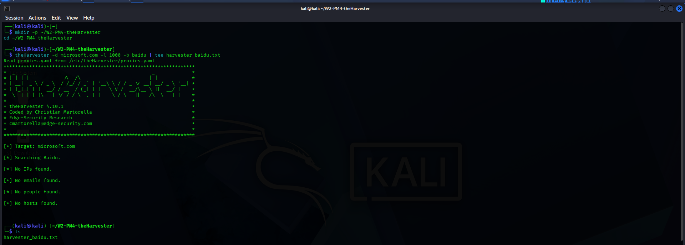
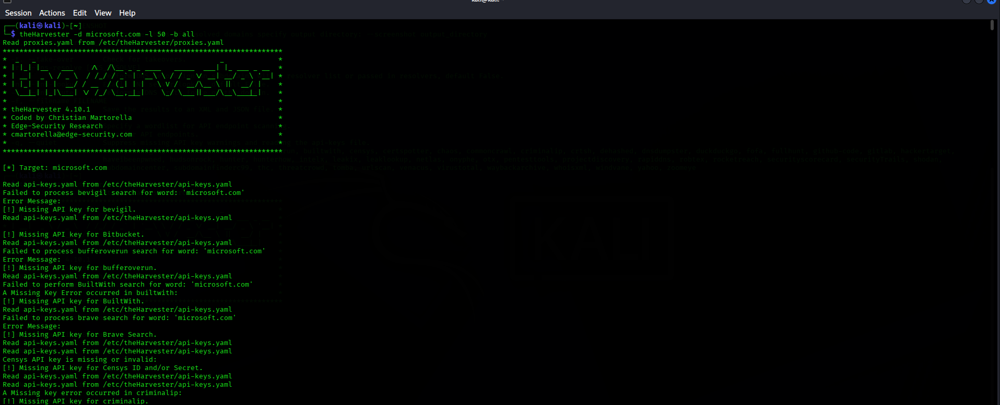
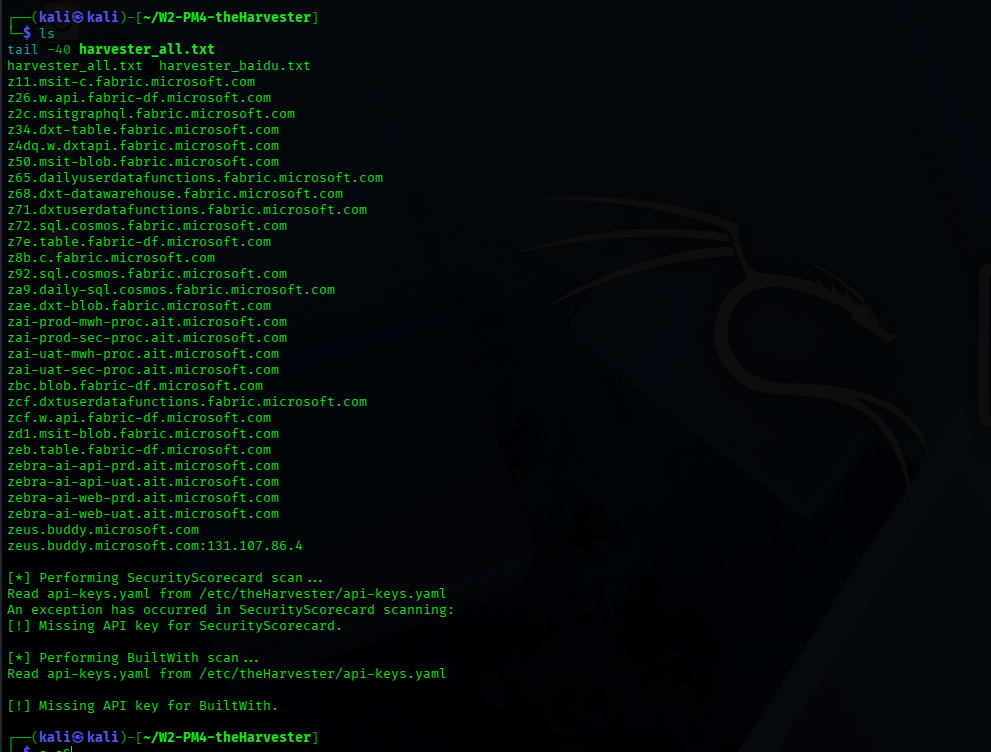

# Module 1: OSINT footprinting with theHarvester

**Goal:** gather sub-domains, hosts, IPs and emails for a target domain from public sources, without touching the target directly.

**Tool:** theHarvester 4.10.1 on Kali Linux. Docs: <https://github.com/laramies/theHarvester> and <https://www.kali.org/tools/theharvester/>.

**Target used:** `microsoft.com` (a public domain used as the lab target; passive public sources only).

## Setup

```bash
mkdir -p ~/W2-PM4-theHarvester
cd ~/W2-PM4-theHarvester
```

## Task 1: Baidu source, limit 1000

```bash
theHarvester -d microsoft.com -l 1000 -b baidu | tee harvester_baidu.txt
```

- `-d` target domain, `-l` result limit, `-b` data source.
- `tee` saves the full output to a file and still prints it on screen.

**Result:** no IPs, emails, people or hosts were found with Baidu.



## Task 2: all sources, limit 50

```bash
theHarvester -d microsoft.com -l 50 -b all | tee harvester_all.txt
```

**Result:**
- Sources that need an API key printed "Missing API key" messages (for example bevigil, Bitbucket, bufferoverun, BuiltWith, Brave Search, Censys, criminalip and SecurityScorecard).
- Sources that need no key still returned a long list of sub-domains, for example under `fabric.microsoft.com`, `fabric-df.microsoft.com`, `ait.microsoft.com` and `buddy.microsoft.com`.
- One entry came with an IP: `zeus.buddy.microsoft.com` with `131.107.86.4`.




## Saved output

The full text output is in [`output/`](output/): `harvester_baidu.txt` and `harvester_all.txt`.

## Notes

- Results change over time because online sources change how they respond to automated queries.
- To use more sources, add your own API keys to `/etc/theHarvester/api-keys.yaml`.
- `theHarvester -h` lists all options and sources. See [`screenshots/theharvester-help-options.png`](screenshots/theharvester-help-options.png).

## Why it matters

Each sub-domain is another possible entry point that a defender may have forgotten. Because the tool only reads public data, the target cannot see that it is being studied. Defenders can run it on their own domain to see what an attacker would see.
