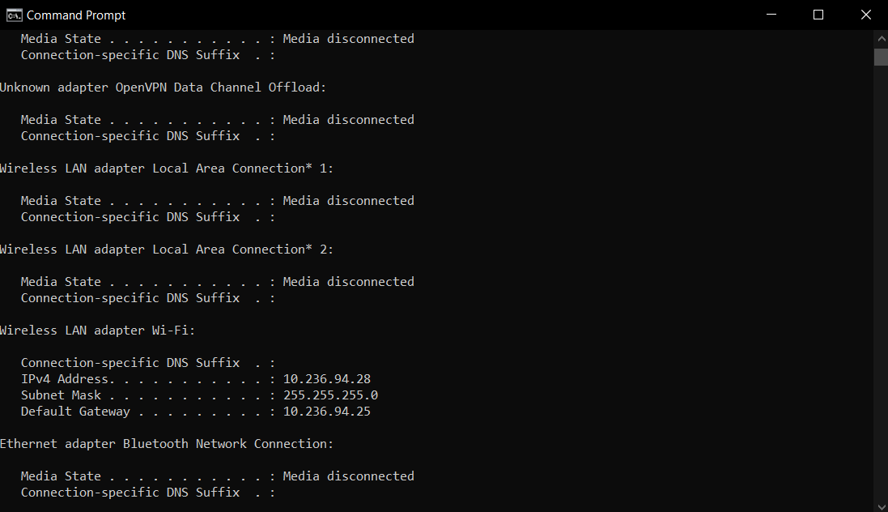
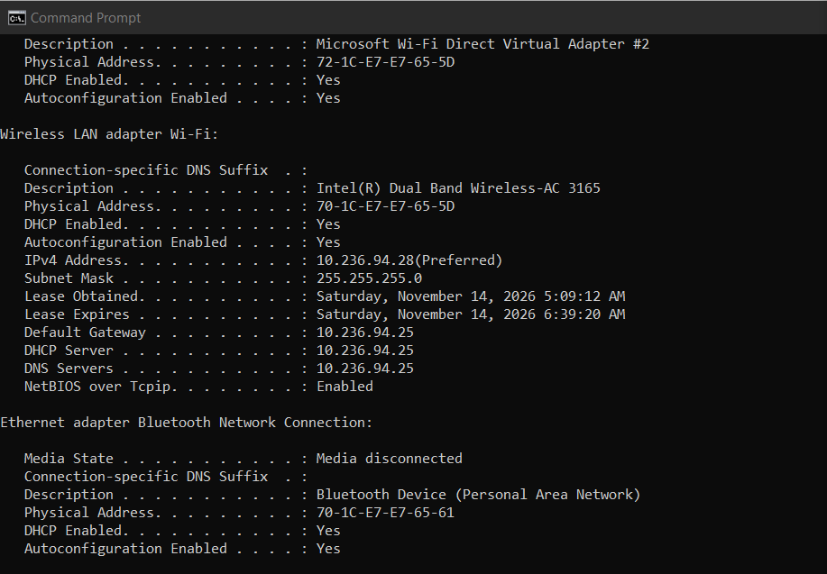
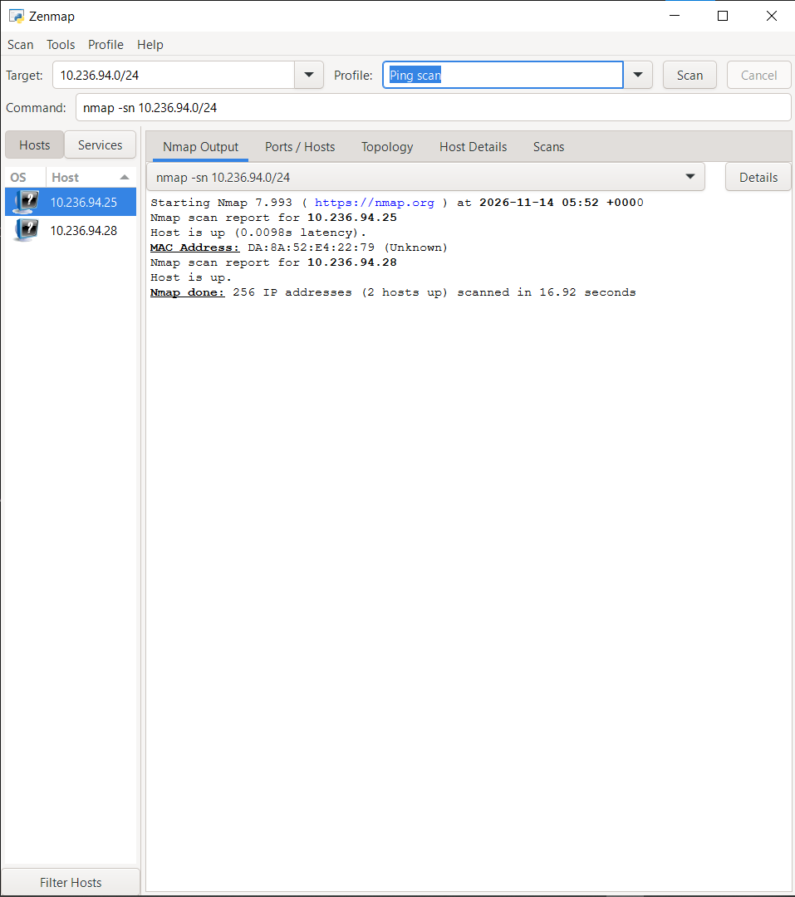
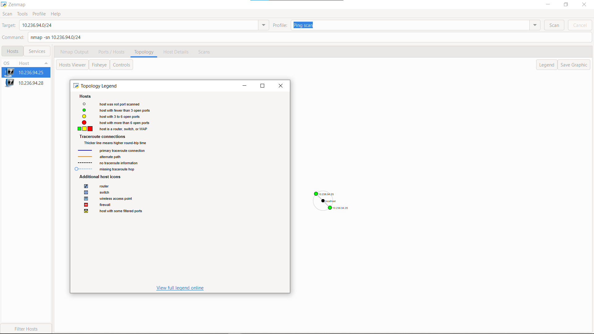

# Module 2: Network scanning with Zenmap

**Goal:** find your own IP address and subnet, discover the live hosts on your network, record their IP and MAC addresses, and save the network topology as a PDF.

**Tool:** Zenmap (the Nmap GUI) on Windows. Download: <https://nmap.org/download.html>. Docs: <https://nmap.org/book/zenmap.html>.

> Only scan a network you own or have written permission to test. This lab was run on the author's own phone hotspot with no VPN active.

## Steps

### 1. Find your IP address and subnet

```cmd
ipconfig
```

Use the adapter that is actually connected (here, the Wi-Fi adapter). Results:

| Item | Value |
| --- | --- |
| IPv4 address | 10.236.94.28 |
| Subnet mask | 255.255.255.0 |
| Default gateway | 10.236.94.25 |
| Subnet to scan | 10.236.94.0/24 |



### 2. Find your own MAC address

```cmd
ipconfig /all
```

The Wi-Fi adapter's physical address is `70-1C-E7-E7-65-5D`. Zenmap does not list the scanning computer's own MAC, so it comes from here.



### 3. Ping scan

In Zenmap set **Target** to `10.236.94.0/24`, **Profile** to **Ping scan** and click **Scan**. The profile runs:

```bash
nmap -sn 10.236.94.0/24
```

**Result:** 256 IP addresses scanned in 16.92 seconds, **2 hosts up** (including this PC).



| Host | IP address | MAC address |
| --- | --- | --- |
| Default gateway | 10.236.94.25 | DA:8A:52:E4:22:79 (vendor unknown) |
| This PC | 10.236.94.28 | 70-1C-E7-E7-65-5D |

### 4. Topology

Open the **Topology** tab, click **Legend** to open the legend window, then **Save Graphic** and choose PDF. The saved file is [`topology.pdf`](topology.pdf).



The graph shows this PC at the centre ("localhost") linked to the two hosts. A ping scan does no port scanning or traceroute, so the topology is sparse.

## Lab answers

See [`lab-answers.md`](lab-answers.md).

## Notes

- If you use a VPN, turn it off for this lab. VPN adapters can replace your real subnet in `ipconfig`.
- Your subnet and results will be different from these.
